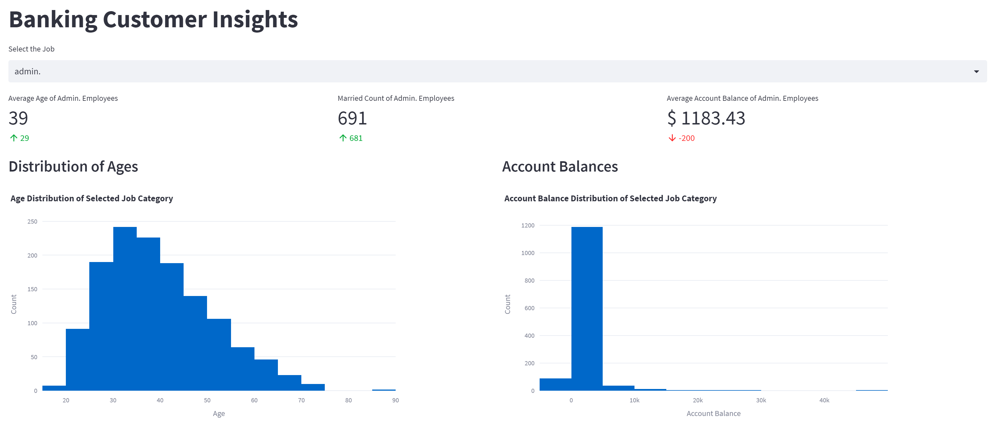

# Banking Customer Insights

**A reproducible customer-analytics dashboard built with Python, pandas, Plotly, and Streamlit.**

Explore demographics, account balances, and term-deposit subscription outcomes in the repository's sample banking-marketing dataset. All KPIs and charts now reflect the **actual filtered records** rather than randomly simulated metric changes.

> This is a static historical sample dashboard. It is not connected to a bank, transaction system, streaming data source, or live customer records.



*Historical application screenshot preserved; it is not a current screenshot of the revised interface.*

## Why the project was updated

The original app used a 200-iteration loop with three-second pauses. It multiplied ages and balances by random factors, added a random number to the count of married customers, and displayed those results as if they were actual data. That behavior was misleading for a portfolio demonstrating business-intelligence quality.

The modernization removes the animation and replaces the output with deterministic, traceable reporting.

## Features

- Filter by **job**, **marital status**, **term-deposit outcome**, and **age**.
- View actual sample **customer count, average age, count married, and mean balance**.
- Calculate term-deposit subscription counts and observed shares using correct denominators.
- Explore age and balance distributions with Plotly charts.
- Compare observed term-deposit subscription shares by job category.
- Inspect filtered records and download an aggregate CSV summary.
- Validate required fields and reject nonnumeric or implausible age values.
- Run automated regression and headless Streamlit startup tests in CI.

**Important definitions:**

| Metric | Calculation |
| --- | --- |
| Customers in sample | Number of filtered CSV rows |
| Average age | Mean of the filtered `age` values |
| Married customers | Count of filtered `marital == married` rows |
| Average balance | Mean of source `balance` values, in the **source's unspecified currency units** |
| Deposit subscribers | Count of filtered `deposit == yes` rows |
| Subscription share | Deposit subscribers divided by filtered customer count |

Negative account balances are permitted. The dashboard does not manufacture percentage-change deltas or compare against fictional targets. Subscription shares describe the selected sample, not the population of a bank.

## Local setup

Use Python **3.11+**:

```bash
python -m venv .venv
# Activate your environment using the relevant shell command.
python -m pip install -r requirements.txt
python -m streamlit run app.py
```

Run tests:

```bash
python -m pip install -r requirements-dev.txt
python -m pytest -q
```

No database server or external API key is needed to run the dashboard; the app reads `Resources/Bank.csv` relative to its own location.

## Data provenance and limitations

- **Input:** `Resources/Bank.csv`, a pre-existing dataset committed to this repository.
- **Provenance:** The file resembles publicly distributed bank-marketing data, but its original source, exact variant, licensing, and sampling method have **not yet been independently confirmed**. Verify these before commercial reuse or redistributed derivative datasets.
- **Not real-time:** The app is a descriptive analysis of a fixed sample. Changes to filters alter the subset, not the source dataset.
- **No forecasting:** Job-category differences do not establish causality or predict future deposit behavior.
- **Selection bias:** The original dataset may not be representative of a broader population. Missing or unknown categorical values may be present.
- **Privacy:** Do not upload or commit confidential bank/customer records to this public repository.

## Project structure

| Path | Purpose |
| --- | --- |
| `app.py` | Streamlit UI, filters, KPIs, and charts |
| `analytics.py` | Pure data checks, filtering, KPI formulas, and grouping |
| `Resources/Bank.csv` | Existing fixed sample CSV (unchanged) |
| `tests/` | Calculation and headless-app tests |
| `.github/workflows/ci.yml` | Continuous integration |
| `Images/app.png` | Preserved historical screenshot |

## Deployment

Original app URL: [bankingcustomers.streamlit.app](https://bankingcustomers.streamlit.app/). Live availability and deployment of the revised code have **not** been independently verified.

When deploying on Streamlit Community Cloud, use `app.py` as the entry point. Verify filters, charts, KPI results, and downloaded summaries in a real browser before promoting the revised deployment.

## History

The project began as an experiment with animated Streamlit dashboards. Its original code is preserved in Git history. The updated version prioritizes **truthful metrics, source traceability, reproducible calculations, and test coverage** over simulated motion.
